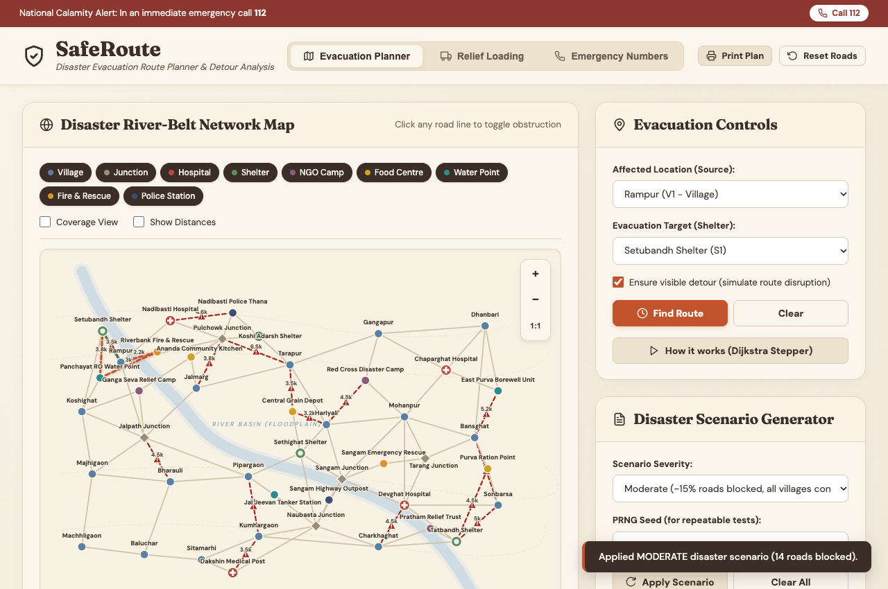
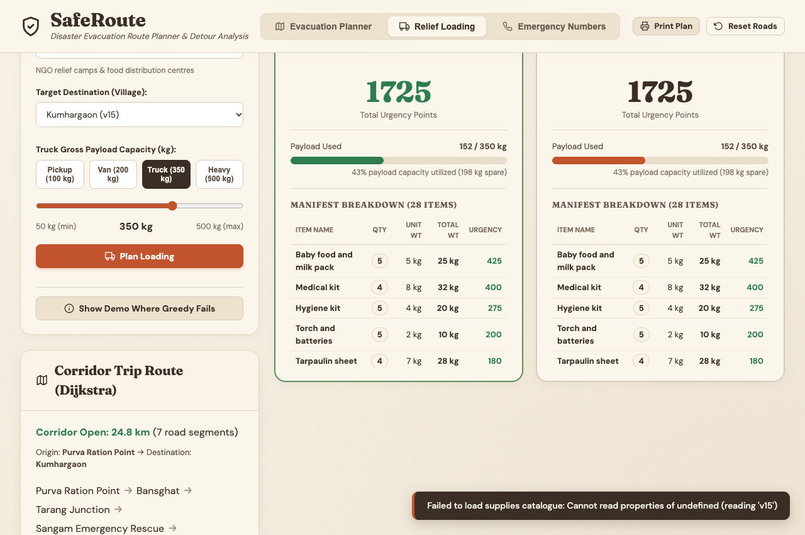
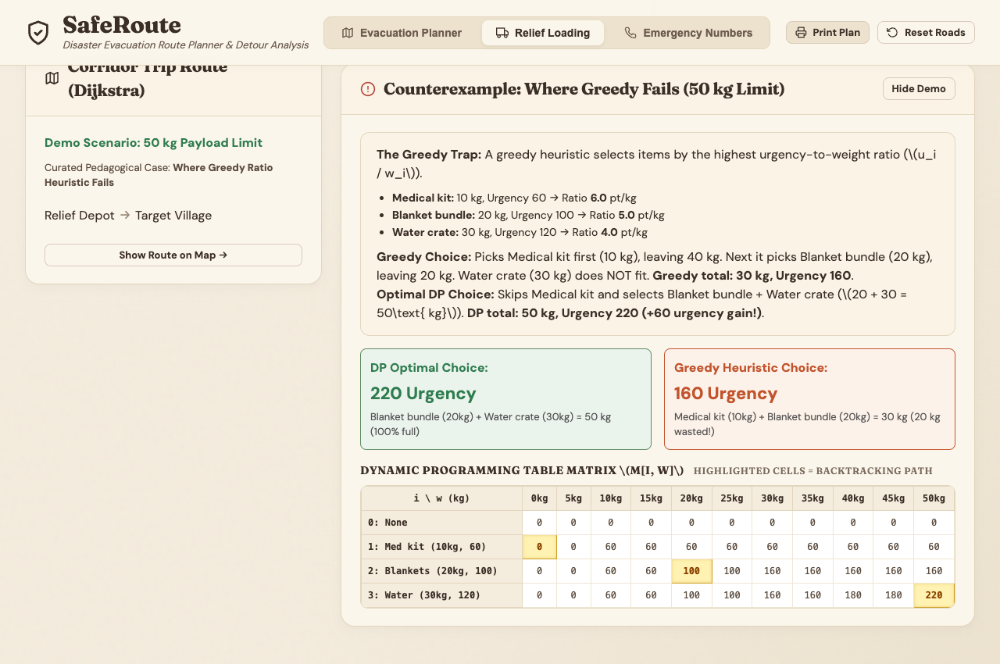
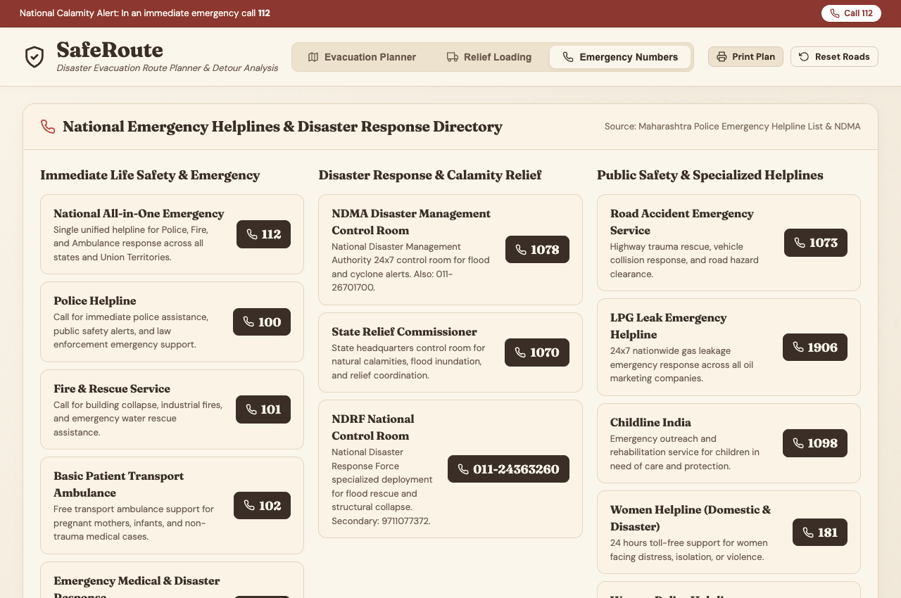

# SafeRoute — Disaster Evacuation Route Planner & Relief Operations Engine

> **A real-time disaster evacuation routing engine and humanitarian relief payload optimizer built in C++17 with an interactive warm-beige web visualization and zero external dependencies.**

> [!NOTE]
> **Academic Context & Disclaimer**:
> This project is a college mini project for the **Design and Analysis of Algorithms** course (**PBL-III**). All road distances, facility names, village boundaries, and facility contact numbers in the road network are fictional and designed for algorithmic simulation. Emergency helpline numbers (112, 1070, NDRF, etc.) are national numbers and must be verified locally before real-world reliance.

---

## 1. Problem Definition & Overview

During sudden natural calamities (river-belt monsoonal flooding, flash inundations, dam overflows, or earthquake structural damage), ground transit networks experience immediate disruptions. Roads submerge, bridges collapse, and power lines or fallen trees obstruct critical access corridors.

Standard navigation tools fail during active calamities because they rely on delayed crowd-sourced traffic and assume all roads are passable. **SafeRoute** models a flood-prone river-basin network as an undirected, weighted graph coupled with an integer humanitarian knapsack engine:
- **Nodes (44 Facilities)**: 18 villages, 8 transit junctions, 3 hospitals/trauma posts, 4 high-capacity evacuation shelters, 3 NGO relief camps, 3 food distribution centres, 3 drinking water points, 1 fire & water rescue station, and 1 police outpost.
- **Edges (90 Roads)**: Physical road segments with metric distances (in kilometers), each capable of tracking disaster status and specific blockage reasons (e.g., *"Flooded road"*, *"Bridge damaged"*, *"Power lines down"*).
- **Relief Supply Catalogue & Village Needs**: 10 essential disaster relief commodities (drinking water crates, food packet boxes, emergency trauma kits, baby food & milk packs, life jackets, hygiene packs, woollen blanket bundles, heavy tarpaulin sheets, torches & batteries, portable stoves). Each village has surveyed emergency demand that exceeds standard vehicle payload limits.

SafeRoute provides emergency responders, district magistrates, and relief coordinators with:
1. **Dynamic Detour Calculation**: Instantly computes optimal alternative routes on open roads when primary corridors fail.
2. **Relief Truck Payload Optimizer (0/1 Knapsack DP)**: Maximizes humanitarian urgency delivered to affected communities under truck weight limits, compared side-by-side with a greedy ratio heuristic.
3. **Deterministic Disaster Scenarios**: Reproducible simulation of calamity severity (Light ~8%, Moderate ~15%, Severe ~25%) with seeded PRNG.
4. **Multi-Source Shelter Coverage**: Identifies which relief shelter serves each village and flags cut-off communities that require boat or airlift rescue.
5. **Nearest Relief Services**: Groups closest medical facilities, potable water stations, food depots, and rescue stations with demo contacts.
6. **Algorithmic Step-by-Step Stepper**: Traces Dijkstra min-heap execution states step-by-step for academic review and operational auditing.
7. **Printable Evacuation & Manifest Orders**: Print-formatted report generator (`window.print()`) for offline field dispatch.
8. **Emergency Directory**: National emergency numbers (112, 100, 101, 102, 108, NDMA, NDRF) and flood survival protocols.

---

## 2. System Architecture & Tech Stack

SafeRoute is built with zero external runtime dependencies and functions entirely offline:

- **Backend & Algorithm Engine**: C++17 (`std::priority_queue`, `std::vector`, `std::unordered_map`, `std::mt19937`).
- **HTTP Web Server**: `cpp-httplib` (single-header embedded HTTP server, stored offline in `third_party/httplib.h`).
- **JSON Serialization**: `nlohmann/json` (single-header JSON library, stored offline in `third_party/json.hpp`).
- **Frontend**: Plain HTML5, CSS3 (Warm beige formal palette, no frameworks, no CDNs), and vanilla JavaScript.
- **Local Typography**: Fraunces (headings and big metric numbers) and DM Sans (body and controls), loaded locally via `@font-face` from `web/fonts/` with Georgia and system-ui fallbacks.
- **Network & Supply Data**: `data/network.json`, `data/supplies.json`, and `data/village_needs.json`.

---

## 3. Project Structure

```
SafeRoute/
├── README.md                 # Complete documentation, algorithm analysis & guide
├── CMakeLists.txt            # Optional CMake build configuration
├── data/
│   ├── network.json          # 44 nodes, 90 roads disaster river-basin network
│   ├── supplies.json         # 10 emergency supply items with weights and urgency
│   └── village_needs.json    # Fixed-seed emergency requirements for all 18 villages
├── include/
│   ├── graph.h               # Adjacency list, facility nodes, and disaster operations
│   ├── dijkstra.h            # Dijkstra, multi-source coverage & trace recorder
│   ├── knapsack.h            # 0/1 Knapsack DP, Greedy heuristic & Brute-force solver
│   └── server.h              # Embedded HTTP server interface
├── LICENSE                   # MIT License
├── THIRD_PARTY_NOTICES.md    # Open source notices & licenses
├── docs/
│   └── screenshots/          # Application walkthrough visual captures
│       ├── planner-route.png
│       ├── relief-loading.png
│       ├── knapsack-demo.png
│       └── emergency-numbers.png
├── src/
│   ├── graph.cpp             # JSON loader, scenario generator, coverage & services
│   ├── dijkstra.cpp          # Single-pair, multi-source Dijkstra and step-by-step trace
│   ├── knapsack.cpp          # Knapsack DP matrix, backtracking path, & greedy ratio
│   ├── server.cpp            # REST API endpoints & static asset router
│   └── main.cpp              # Dual-mode entry point (Web Server & CLI)
├── tests/
│   └── test_main.cpp         # 24 automated assert-based unit and integration tests
├── third_party/
│   ├── httplib.h             # Single-header embedded HTTP server (MIT)
│   └── json.hpp              # Single-header JSON library (MIT)
└── web/
    ├── index.html            # Semantic HTML layout with SVG map viewport & 3 tabs
    ├── style.css             # Warm beige formal design system & print stylesheet
    ├── app.js                # SVG map renderer, knapsack controller, & API client
    ├── emergency.json        # Verified national emergency numbers & flood safety tips
    └── fonts/                # Local woff2 fonts (Fraunces & DM Sans)
        ├── fraunces-600.woff2
        ├── fraunces-700.woff2
        ├── dmsans-400.woff2
        ├── dmsans-500.woff2
        ├── dmsans-700.woff2
        ├── OFL-Fraunces.txt  # SIL Open Font License 1.1
        └── OFL-DMSans.txt    # SIL Open Font License 1.1
```

---

## 4. Build and Run Instructions

SafeRoute compiles with a single standard `g++` command.

### Detected Environment: macOS (Darwin / Apple Clang)

#### 1. Compile SafeRoute (macOS & Linux):
```bash
g++ -std=c++17 -Wall -Wextra \
  src/main.cpp src/server.cpp src/graph.cpp src/dijkstra.cpp src/knapsack.cpp \
  -lpthread -o saferoute
```

#### 2. Compile SafeRoute (Windows with MinGW-w64):
```cmd
g++ -std=c++17 -Wall -Wextra ^
  src/main.cpp src/server.cpp src/graph.cpp src/dijkstra.cpp src/knapsack.cpp ^
  -lws2_32 -lpthread -o saferoute.exe
```

---

### Running SafeRoute

#### Web Application Mode (Default):
```bash
./saferoute
```
Open your browser and navigate to:
**`http://localhost:8080`**

To specify a custom port or alternate data file:
```bash
./saferoute --port 9000 --data data/network.json
```

#### Command-Line Interface (CLI Mode):
```bash
./saferoute --cli
```
Allows testing routes, scenarios, coverage, and relief truck loading directly from your terminal.

---

## 5. How to Run the Automated Test Suite

SafeRoute includes a self-contained assert-based test runner.

### Compile and Run Tests:
```bash
g++ -std=c++17 -Wall -Wextra \
  tests/test_main.cpp src/graph.cpp src/dijkstra.cpp src/knapsack.cpp \
  -o test_runner && ./test_runner
```

### Test Suite Results:
| Test Description | Verified Behavior | Status |
|---|---|---|
| Normal shortest path | Computes optimal route $v1 \to s1 = 7.0\text{ km}$ | **PASS** |
| Road block forces detour | Blocking bridge forces longer detour ($7.0\text{ km} \to 14.0\text{ km}$) | **PASS** |
| Total ingress block | Isolated node returns `reachable: false` and distance $\infty$ | **PASS** |
| Source equals destination | Returns distance $0.0\text{ km}$ and path $[v1]$ | **PASS** |
| Obstruction reasons stored | Reasons stored on road block and cleared on restore | **PASS** |
| Scenario seed reproducibility | Identical seed yields identical road blockages | **PASS** |
| Light & Moderate connectivity | Preserves at least 1 reachable shelter for every village | **PASS** |
| Nearest services grouping | Groups closest hospital, water, food, and rescue posts | **PASS** |
| Multi-source coverage equivalence | Multi-source Dijkstra matches minimum of independent runs | **PASS** |
| Dijkstra trace parity | Stepper trace matches standard Dijkstra distance and path | **PASS** |
| Disrupt-route validation | Only blocks roads on the active original path | **PASS** |
| Exception handling | Rejects invalid node IDs, road IDs, and negative distances | **PASS** |
| Road restoration | Unblocking a road restores optimal route | **PASS** |
| Full network data loading | Ingests 44 nodes, 90 roads, contacts, and operational notes | **PASS** |
| Knapsack DP vs Brute-force | DP equals brute-force exact optimal across 50 random test instances | **PASS** |
| Knapsack 160 vs 220 demo | Exact verification: Greedy chooses 160 pts, DP chooses 220 pts (+60 gain) | **PASS** |
| Knapsack DP $\ge$ Greedy | DP total urgency never less than Greedy heuristic across 100 random runs | **PASS** |
| Knapsack capacity 0 | Zero capacity returns 0 items, 0 weight, 0 urgency cleanly | **PASS** |
| Items heavier than capacity | Overweight items are never chosen by solver | **PASS** |
| All items fit | When total weight $\le$ capacity, all candidate items are selected | **PASS** |
| Payload limit adherence | Total chosen weight never exceeds truck capacity limit (50 runs) | **PASS** |
| Knapsack invalid input handling | Negative weights or capacities out of bounds return clean error | **PASS** |
| Knapsack cut-off village | Isolated destination returns `reachable: false` cleanly with zero crash | **PASS** |
| Manifest breakdown integrity | Sum of grouped manifest rows equals total weight & urgency across plans | **PASS** |

---

## 6. Interface & Visualizations

### 1. Evacuation Route Planner (Detour Around Disaster Obstructions)


### 2. Relief Truck Loading Optimizer (0/1 Knapsack DP vs Greedy Heuristic)


### 3. Knapsack Educational Counterexample & 2D DP Matrix Visualizer


### 4. Verified National Emergency Directory & Flood Safety Guidance


---

## 7. Interactive Demo Walkthrough

### Tab 1: Evacuation Planner
1. **Default Moderate Scenario**:
   - On page load, SafeRoute automatically initializes with a **Moderate Disaster Scenario** (seed `2026`).
   - Active obstructions display in the right panel and on the map with red dashed lines and warning triangle markers showing specific reasons (e.g., `R22: Jalpath Junction <-> Pipargaon (Flooded road)`).
2. **Calculate Evacuation Route with Detour**:
   - Choose Affected Location: **Rampur (V1)**.
   - Leave Evacuation Target set to **Auto (Nearest Open Shelter)**.
   - Click **Find Route**.
   - SafeRoute's **Ensure visible detour** feature simulates a realistic obstruction along the corridor, displays an informational banner, and calculates the revised detour in orange compared to the green baseline with animated directional dash-flow.
3. **Nearest Relief Services**:
   - Lists the 3 closest facilities of each type (Hospital, Water, Food, NGO, Rescue, Police) with distance, operational note, and fictional demo contact.
4. **Multi-Source Shelter Coverage View**:
   - Check the **Coverage View** toggle switch on the map toolbar. Each village is color-coded to its nearest shelter.
5. **Dijkstra Stepper**:
   - Click **How it works (Dijkstra Stepper)** to step through min-heap priority queue states and distance settlements.

### Tab 2: Relief Loading (0/1 Knapsack DP)
1. **Dispatch Configuration**:
   - Select Origin Depot: e.g. **Koshi Relief Base (NGO Camp 1)**.
   - Select Target Village: e.g. **Rampur (V1)**.
   - Observe the total village demand (~184 kg across 28 units).
   - Select truck payload limit: click preset **Van (200 kg)** or adjust slider.
2. **Plan Loading**:
   - Click **Plan Loading**.
   - SafeRoute runs Dijkstra on the open road network to compute delivery corridor distance and waypoints.
   - Side-by-side comparison cards display **Optimal Load (DP)** vs. **Quick Heuristic (Greedy)**, weight usage bars, item manifest breakdown, and the central **Urgency Gain Callout** (e.g. `+35 Urgency gained by DP over greedy heuristic`).
3. **Show Route on Map**:
   - Click **Show Route on Map** to immediately switch to the map and visualize the ground corridor from depot to village.
4. **Educational Counterexample (Where Greedy Fails)**:
   - Click **Show Demo Where Greedy Fails**.
   - Displays the classic 50 kg counterexample:
     - Medical kit: 10 kg, Urgency 60 (Ratio 6.0 pt/kg)
     - Blanket bundle: 20 kg, Urgency 100 (Ratio 5.0 pt/kg)
     - Water crate: 30 kg, Urgency 120 (Ratio 4.0 pt/kg)
   - Demonstrates that Greedy selects Medical kit + Blankets (30 kg, Urgency 160, wasting 20 kg), while DP selects Blankets + Water (50 kg, Urgency 220, achieving +60 urgency gain).
   - Highlights the exact backtracking path through the rendered 2D Dynamic Programming matrix $M[i, w]$.

### Tab 3: Emergency Numbers & Directory
- View verified Indian national emergency helplines (112, 100, 101, 102, 108, 1070, 1078, NDRF) with tap-to-call links and flood safety tips.

### Printable Operations Order
- Click **Print Plan** in the top header to preview/print the combined evacuation detour analysis and active relief loading manifest.

---

## 7. API Reference

SafeRoute provides 14 REST API endpoints exchanging JSON:

### `GET /api/network`
Returns all 44 nodes, 90 roads, demo contacts, notes, and disaster obstruction reasons.

### `POST /api/compare`
Calculates and compares original baseline route vs. disaster-adjusted revised route.
- **Request**: `{"source": "v1", "destination": "s1"}`
- **Response**: Original distance/path, revised distance/path, `extraKm`, `percentIncrease`, and list of road blocks affecting the original corridor.

### `GET /api/supplies`
Returns the 10-item disaster supply catalogue and surveyed village needs.

### `POST /api/load-plan`
Calculates Dijkstra trip route and compares 0/1 Knapsack DP vs. Greedy ratio heuristic.
- **Request**: `{"depotId": "ngo1", "villageId": "v1", "capacityKg": 200}`
- **Response**: `reachable`, `routeDistanceKm`, `routePath`, `dp` result, `greedy` result, and `urgencyGain`. If unreachable, returns `reachable: false` and error explanation.

### `GET /api/load-demo`
Returns the canonical 50 kg counterexample where greedy ratio fails, complete with the full $4 \times 51$ DP table and backtracking path coordinate cells.

### `POST /api/shelters`
Ranks all evacuation shelters from a source location.
- **Request**: `{"source": "v1"}`

### `POST /api/services`
Finds nearest facilities grouped by type (hospital, shelter, ngo, food, water, fire_station, police).
- **Request**: `{"source": "v1"}`

### `POST /api/block`
Blocks a road with an explicit disaster reason.
- **Request**: `{"road": "r12", "reason": "Landslide debris"}`

### `POST /api/restore`
Restores a previously blocked road to open status.
- **Request**: `{"road": "r12"}`

### `POST /api/reset`
Restores all roads across the entire network to open and clears reasons.

### `POST /api/scenario`
Applies a seeded disaster scenario.
- **Request**: `{"severity": "moderate", "seed": 2026}`

### `POST /api/disrupt-route`
Simulates a realistic disruption on the active path to evaluate detour alternatives.
- **Request**: `{"source": "v1", "destination": "s1", "seed": 42}`

### `POST /api/trace`
Executes Dijkstra on the active network and records internal priority queue states and edge relaxations.
- **Request**: `{"source": "v1", "destination": "s1"}`

### `GET /api/coverage`
Executes multi-source Dijkstra from all open shelters to calculate village coverage.

---

## 8. Algorithmic Analysis & Complexity

### 1. Relief Truck Loading (0/1 Knapsack Problem)

#### Problem Formulation:
Given $n$ indivisible supply units, each with integer weight $w_i > 0$ and priority urgency $u_i \ge 0$, and a truck gross payload limit $W \le 5000\text{ kg}$, select binary decision variables $x_i \in \{0, 1\}$ to:
$$\text{Maximize } \sum_{i=1}^n u_i x_i \quad \text{subject to} \quad \sum_{i=1}^n w_i x_i \le W$$

#### Optimal Substructure & Recurrence Relation:
Let $M[i, w]$ be the maximum urgency achievable considering the first $i$ items with capacity $w$:
$$M[i, w] = \begin{cases}
0 & \text{if } i = 0 \text{ or } w = 0 \\
M[i-1, w] & \text{if } w_i > w \\
\max\Big(M[i-1, w],\; M[i-1, w - w_i] + u_i\Big) & \text{if } w_i \le w
\end{cases}$$

#### Backtracking Recovery:
Starting at cell $(n, W)$:
- If $M[i, w] > M[i-1, w]$, item $i$ was included. Record item $i$ and transition to $w \leftarrow w - w_i, i \leftarrow i - 1$.
- Otherwise, item $i$ was omitted. Transition to $i \leftarrow i - 1$.

#### Complexity Analysis:
- **Time Complexity**: $\Theta(n \cdot W)$ — The table of size $(n + 1) \times (W + 1)$ has each entry computed in $\mathcal{O}(1)$ time. This is **pseudo-polynomial** time (polynomial in the numeric value of $W$, but exponential in the number of bits $\log W$ required to represent $W$).
- **Space Complexity**: $\Theta(n \cdot W)$ — To enable exact reconstruction of the selected manifest and UI matrix inspection.
- **Greedy Comparison Heuristic**: Sort items in descending order of efficiency ratio $r_i = u_i / w_i$ in $\mathcal{O}(n \log n)$ time, then take items while capacity permits.
- **Why Greedy Fails**: Greedy is optimal for the *fractional* knapsack problem (where items can be cut), but fails for the *0/1 integer* knapsack problem because leaving capacity unfilled cannot be recovered by dividing the next best item.

---

### 2. Dijkstra's Shortest Path Algorithm

Dijkstra's algorithm solves Single-Source Shortest Path (SSSP) on graphs with non-negative edge weights ($w(u, v) > 0$).

1. **Priority Queue Min-Heap**: A min-heap `std::priority_queue<std::pair<double, std::string>, ...>` maintains candidate nodes ordered by tentative distance.
2. **Stale Entry Elimination**: When edge relaxation updates a tentative distance, a new $(d, v)$ pair is pushed into the heap. Outdated pairs popped later are discarded in $\mathcal{O}(1)$ using a `visited` set.
3. **Early Termination**: When targeting a specific shelter or village, execution stops immediately when that target node is settled.
4. **Complexity**: $\mathcal{O}((V + E) \log V)$ time and $\mathcal{O}(V + E)$ space.

---

### 3. Complexity Comparison

| Algorithm | Problem Solved | Time Complexity | Space Complexity | Optimality Guarantee |
|---|---|---|---|---|
| **0/1 Knapsack DP (SafeRoute)** | Truck Payload Optimization | $\Theta(n \cdot W)$ | $\Theta(n \cdot W)$ | **Guaranteed Global Optimum** |
| **Knapsack Greedy Heuristic** | Truck Payload Heuristic | $\mathcal{O}(n \log n)$ | $\mathcal{O}(n)$ | Suboptimal heuristic (ratio trap) |
| **Knapsack Brute Force** | Exact Verification Benchmark | $\mathcal{O}(2^n)$ | $\mathcal{O}(n)$ | Guaranteed Global Optimum (intractable for $n > 25$) |
| **Dijkstra (SafeRoute Engine)** | Shortest Safe Evacuation Route | $\mathcal{O}((V + E) \log V)$ | $\mathcal{O}(V + E)$ | **Guaranteed Minimum Distance** |
| **Multi-Source Dijkstra** | Territory Shelter Catchment | $\mathcal{O}((V + E) \log V)$ | $\mathcal{O}(V + E)$ | **Guaranteed Catchment Assignment** |

---

## 10. Assumptions, Limitations & Future Work

### Limitations
1. **Single-Truck Optimization**: The knapsack solver currently optimizes one truck payload dispatch per run. Future extensions could model multi-vehicle fleets with varied capacities (Bin Packing Problem / Multiple Knapsack).
2. **Static Demand**: Village requirements are loaded from surveyed relief needs and do not fluctuate over time during a single dispatch cycle.
3. **Illustrative River-Belt Dataset**: Node coordinates, village names, and phone numbers (`00000 01234`) are synthetic models designed for academic coursework demonstration. Real emergency helplines are provided on the Emergency Numbers tab.

---

## 11. Authors & Course Information

- **Course**: Design and Analysis of Algorithms (PBL-III)
- **Institution**: College Mini Project
- **Authors**:
  - **Samridhi Chourasia** — [GitHub: @samcodes11](https://github.com/samcodes11)
  - **Keerti Singh** — [GitHub: @<!-- TODO: Keerti Singh GitHub handle -->](https://github.com/) *(Collaborator — GitHub username pending)*

---
SafeRoute &copy; 2026 SafeRoute Contributors. Released under the [MIT License](LICENSE). Built with C++17, Vanilla JavaScript, and SVG.
